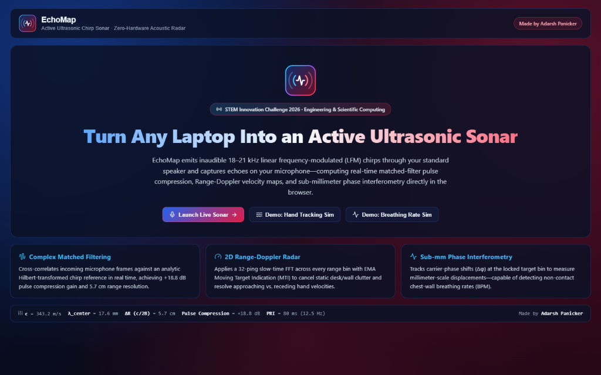
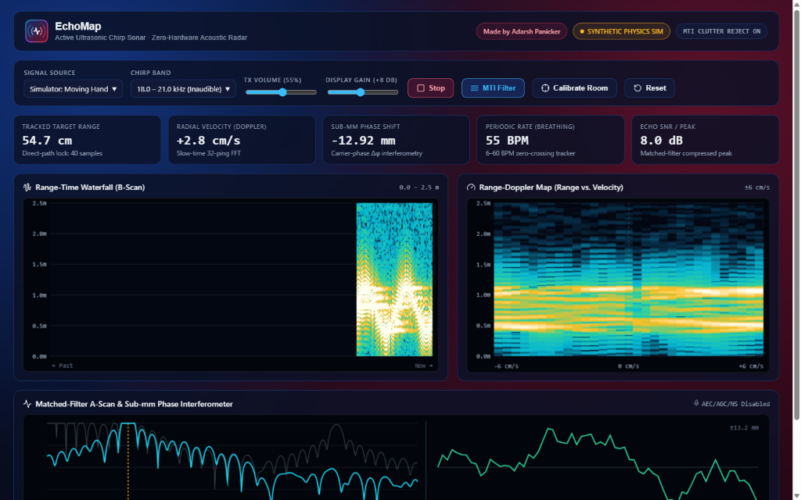
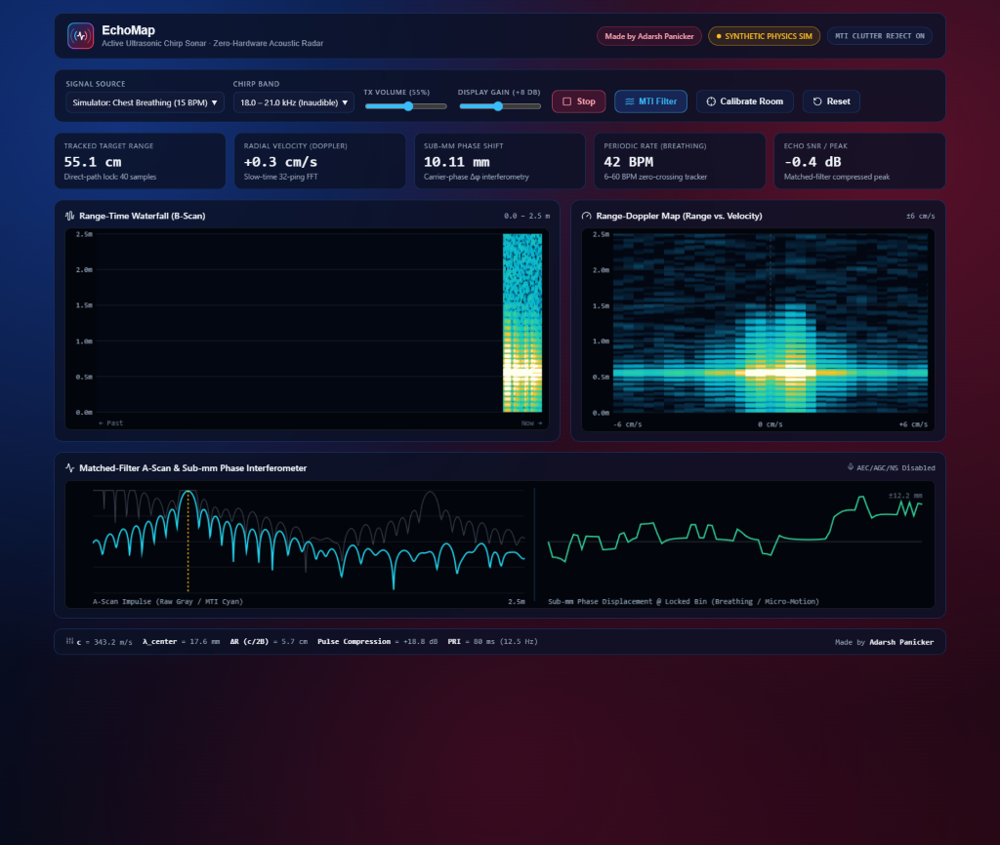

<div align="center">

# EchoMap — Active Ultrasonic Chirp Sonar

**Zero-Hardware FMCW / Matched-Filter Acoustic Radar & Sub-mm Phase Interferometer**

*Built for the STEM Innovation Challenge 2026 (Engineering & Scientific Computing Track)*  
**Made by Adarsh Panicker**

</div>

---

## Overview

**EchoMap** turns any standard laptop into an active near-ultrasonic (**18–21 kHz**) chirp sonar using **only its built-in speaker and microphone**—with zero external hardware and 100% client-side execution in the browser.

By transmitting Tukey-windowed Linear Frequency-Modulated (LFM) chirps and processing microphone echoes through a real-time complex matched filter, EchoMap extracts:
1. **Centimeter-scale target range** via pulse compression (`ΔR = c / 2B`).
2. **Radial velocity (approaching vs. receding)** via a 32-ping slow-time Range-Doppler FFT.
3. **Sub-millimeter micro-motion & breathing rate (BPM)** via carrier-phase interferometry (`Δd = (λ / 4π) Δφ`).

---

## Screenshots

### Home Screen


### Hand Tracking Simulation (Range-Time Waterfall, Range-Doppler Map & A-Scan)


### Non-Contact Breathing Rate Simulation (Sub-mm Phase Interferometer)


---

## How the DSP Pipeline Works

| Stage | Mathematical / Signal Processing Implementation |
| :--- | :--- |
| **1. Chirp Synthesis** | Generates an LFM chirp (`18–21 kHz`, `25 ms` pulse, `80 ms` PRI / `12.5 Hz` ping rate) tapered with a Tukey window (`α = 0.15`) to suppress spectral sidelobes and speaker transients. |
| **2. Synchronous Transceiver** | A custom WebAudio `AudioWorkletProcessor` (`public/sonar-processor.js`) emits chirps and records raw microphone samples (`echoCancellation: false`, `noiseSuppression: false`, `autoGainControl: false`) on the same audio clock. |
| **3. Complex Matched Filter** | Cross-correlates each recorded frame against the conjugated analytic (Hilbert-transformed) chirp spectrum via Radix-2 Cooley-Tukey FFT (`4096` points), yielding `+18.8 dB` pulse compression gain (`B · Tp = 75`) and a smooth complex impulse response `h[n] = I[n] + jQ[n]`. |
| **4. Direct-Path Loop Lock** | Automatically locates the speaker-to-mic direct acoustic bleed peak (`n₀`) to eliminate OS/browser audio buffer latency jitter. |
| **5. MTI Clutter Rejection** | Subtracts an Exponential Moving Average (EMA) background clutter model (`h_mti[n] = h_k[n] - h̄_k[n]`)—or a user-captured static room baseline—so stationary walls and desks vanish. |
| **6. 2D Range-Doppler FFT** | Runs a Hann-windowed 32-ping slow-time FFT across every range bin to resolve radial velocity (`cm/s`) vs. distance (`m`). |
| **7. Phase Interferometry** | Computes `Δφ = atan2(Im(h_k · h*_{k-1}), Re(h_k · h*_{k-1}))` at the locked target bin to track millimeter-scale motion and estimate periodic breathing rate (BPM). |

---

## Quick Start

```bash
# Install dependencies
npm install

# Run DSP unit tests (FFT roundtrip, matched-filter range localization, breathing BPM)
npm test

# Start development server
npm run dev

# Build for production
npm run build
```

> **Tip:** If testing without a microphone or in a noisy environment, select **Demo: Hand Tracking Sim** or **Demo: Breathing Rate Sim** on the Home Screen to run the full physics-based synthetic echo generator through the exact same DSP pipeline.

---

## Project Structure

```text
├── public/
│   └── sonar-processor.js        # Synchronous AudioWorklet transceiver
├── src/
│   ├── audio/
│   │   └── sonarEngine.ts        # WebAudio capture & worklet lifecycle
│   ├── components/
│   │   ├── AScanAndPhaseCanvas.tsx
│   │   ├── EchoMapLogo.tsx       # Custom SVG logo
│   │   ├── RangeDopplerCanvas.tsx
│   │   ├── WaterfallCanvas.tsx
│   │   └── colormap.ts           # Scientific sonar LUT
│   ├── dsp/
│   │   ├── chirp.ts              # LFM chirp & analytic spectrum
│   │   ├── fft.ts                # Zero-allocation Radix-2 FFT
│   │   ├── simulator.ts          # Synthetic acoustic echo simulator
│   │   └── sonarProcessor.ts     # Matched filter, MTI, Range-Doppler, Δφ tracker
│   ├── App.tsx
│   └── index.css
└── tests/
    └── dsp.test.ts               # Node DSP verification suite
```

---

## Author

**Adarsh Panicker**
